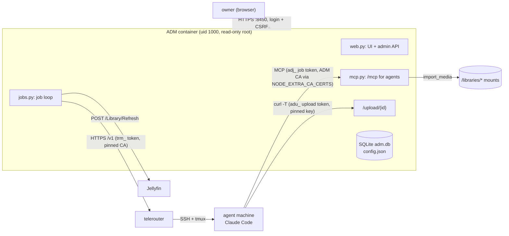

# Architecture

ADM (agentic download manager) turns a media request into a task for an AI agent and files the result into a
media library. It owns no agent runtime of its own: agent sessions come from **telerouter's Sessions API**, and
the agent reaches back into ADM only through ADM's **MCP server** and its **upload endpoint**.

## 1. Components



| File | Role |
|---|---|
| `adm/__main__.py` | uvicorn over HTTPS (self-signed CA from `tls.py`, or your own certificate) |
| `adm/settings.py` | `ADM_*` environment |
| `adm/config.py` | pydantic config (admin, telerouter, Jellyfin, libraries, agent, security); secrets write-only (`redact`/`merge_secrets`) |
| `adm/store.py` | `config.json` (0600, atomic) and SQLite: `requests`, `events`, `uploads`, `imports` |
| `adm/security.py`, `adm/tls.py` | adapted from telerouter (argon2id, tokens as SHA-256, TOTP, throttle, server-side sessions; local CA) |
| `adm/web.py` | FastAPI: auth, requests/libraries/settings API, `/mcp`, `/upload/{id}`, static UI |
| `adm/jobs.py` | the job loop and the agent's prompt |
| `adm/mcp.py` | MCP server (Streamable HTTP, JSON responses, tools only) |
| `adm/library.py` | path checks, folder tree/search, placing files |
| `adm/remote.py` | telerouter and Jellyfin clients (verified TLS, no redirects) |
| `adm/static/` | vanilla JS SPA (no build step, strict CSP) |

## 2. A request's life

```
queued ──(free slot, settings complete)──▶ starting ──(telerouter: working)──▶ working ──▶ done | failed | cancelled
   ▲  telerouter unreachable: back to queued, retry in 60 s                              │
   └──────────────────────────────── retry (owner) ◀──────────────── failed/cancelled ◀──┘
```

1. **Start** (`Jobs._start`): a fresh job token `adj_…` (256-bit; only its hash is kept), then `POST /v1/sessions` with
   name `adm-<id>`, folder `<telerouter.folder>/<id>`, the prompt (`build_prompt`: request, target library, the
   owner's guidance, the working rules, "don't phone or message"), `timeout` = the job timeout, and one MCP server
   `adm` = `<adm_url>/mcp` with the job token and ADM's CA. telerouter writes that into 0600 files on the agent
   machine and starts Claude Code with them (telerouter ARCHITECTURE §4.3.1).
2. **Work**: the agent calls `get_request`, `report_progress`, `list_library`/`find_in_library`, downloads in its job
   folder, then per file `start_upload` → runs the returned `curl` → `import_media(upload_id, path)`.
3. **End**: `complete_request` (needs ≥ 1 import) or `fail_request`. `Jobs.finish` clears the token hash (the token is
   dead at once), discards staged uploads, closes the session (unless *keep sessions*) and logs the state.
4. **Watching** (every 10 s, `Jobs._check`): telerouter's session `state`/`turns`. A turn that ended (`idle`, more
   turns than seen) while the request is still open → the reply goes to the timeline and the agent gets a reminder
   (`max_nudges`, default 2), after that the job fails with the agent's last words. `failed`/`closed` sessions and the
   job timeout fail the job. `lost` (telerouter restarted mid-turn) is waited out until the timeout - the agent's MCP
   calls still arrive meanwhile.
5. **Library scan**: an import into a library with *Jellyfin library scan* schedules one `POST /Library/Refresh`
   30 s later (several files → one scan).

## 3. Uploads

`start_upload(filename, size)` checks the file type for the library kind, the size cap and free space (size + 2 GB),
and creates an upload with its own token `adu_…` (hash stored) valid for that upload only while the request is
open. The returned command is
`curl --fail-with-body -sS --pinnedpubkey sha256//<ADM key> -k -H 'Authorization: Bearer adu_…' -T <file> <adm_url>/upload/<id>`
(with an own certificate: plain verification, no pin). `PUT /upload/{id}` streams to `<staging>/<id>.part`, refuses more
bytes than announced, and resumes with `Content-Range: bytes N-…/size` (`curl -C N`), answering 416 with
`received_bytes` when N does not match. One PUT per upload at a time.

`import_media` → `library.place`: `clean_rel` (relative, NFC, no `..`, no hidden/control/`<>:"|?*` components, ≤ 200
bytes each), the extension allow-list of the library kind, `_inside` walks every component with `lstat` (no symlinks,
folders only, missing folders created 0775), and the file is linked/copied to a hidden temp name and `link()`ed to
the final name, which fails instead of overwriting.

## 4. Design decisions

| Decision | Why |
|---|---|
| Agents come from telerouter, not from ADM's own SSH | one place that owns machines, host keys, tmux and Claude Code's dialogs; the owner sees ADM's sessions on telerouter's tmux page |
| The agent talks to ADM through MCP + HTTPS uploads, never a shared file system | the agent machine needs no access to the libraries; every write is checked by ADM (path, type, no overwrite) |
| One token per job, one per upload | a leaked token reaches one request (or one file) and dies with it; the upload token is in the agent's transcript, the job token only in a 0600 file |
| The agent reads the library structure and names files itself | libraries differ (flat shows, `Season N/` folders, author folders); copying what exists beats a fixed naming scheme |
| Staging then link/copy | partial files never appear in the library; same file system → instant hard link |
| SQLite on the event loop | a few rows per call; one lock; no async driver needed |
| No metadata provider (TMDB etc.) | free text + year is enough for an agent that searches the web; avoids another API key |

## 5. Security and threat model

**Assets**: the libraries (other software reads them), the agent machine (the agent runs commands there), the
telerouter token (it can start agent sessions), the Jellyfin API key.

| Threat | Mitigation |
|---|---|
| Someone on the LAN claims the admin | one-time setup code from the log (or `ADM_SETUP_CODE`) |
| Password guessing | argon2id; per-IP and per-account throttle with growing locks + global cap; generic errors; constant-time compares; optional TOTP (replay-protected) |
| Session theft / CSRF / clickjacking | server-side sessions in a `__Host-adm` cookie (Secure, HttpOnly, SameSite=Strict), rotated on login, idle + absolute timeouts, logout and password change delete them; CSRF token on every state change + Fetch-Metadata refusal; `X-Frame-Options: DENY` |
| XSS | strict CSP (`script-src 'self'`, no inline script/style); DOM built with `textContent` only (titles, agent replies and the agent's screen are data) |
| Secrets in the API | telerouter token and Jellyfin key are write-only (`*_set` flags); job/upload tokens never shown; no secret in URLs or logs |
| The admin's folder suggestions reveal the file system | `GET /api/folders` needs the admin session, lists folders only (no files), only below `ADM_LIBRARY_ROOTS` (checked on the real path, symlinks and hidden names skipped, `..` refused) |
| A rogue or confused agent writes outside the library | it has no file access to ADM's host; `import_media` confines paths (no `..`, symlinks, hidden names), allows only media types of the library kind and never overwrites; libraries must lie below `ADM_LIBRARY_ROOTS` (keeps `/data` out of reach) |
| A leaked job/upload token | 256-bit, hashed, scoped to one request / one upload, dead when the job ends; bad tokens throttled per IP; `/mcp` refuses browser origins |
| Upload abuse (disk filling) | announced size enforced, per-file cap (`ADM_MAX_UPLOAD_GB`), free-space check, ≤ 50 open uploads per request, staged files deleted when a job ends |
| A compromised ADM | it holds a telerouter `sessions` token: it can start agent sessions on machines where the owner allowed API sessions. Keep that to a dedicated agent machine/user; revoke the token in telerouter to cut ADM off |
| Prompt injection from web pages the agent reads | the agent's own permission mode applies (telerouter's new-session setting, `auto` by default); its ADM tools can only touch this one request; it is told not to phone or message |
| MITM | outbound TLS always verified (pinned private CAs for telerouter/Jellyfin, never `verify=False`), no redirects; agents trust ADM's CA for MCP and pin ADM's key for uploads |
| Agent endpoints exposed on a public name | agents use the LAN address; the documented proxy setup returns 404 for `/mcp` and `/upload/` on the public host, and those endpoints accept only job/upload tokens anyway |
| Container escape / privilege | uid 1000, read-only root, `cap_drop: ALL`, `no-new-privileges`, memory/pid limits |

Not covered: what the agent downloads and from where is decided by the agent under the owner's guidance; ADM
checks file types and placement, not content or licensing.

## 6. Platform constraints

- Claude Code is required on the agent machine for per-session MCP servers (telerouter refuses them for Hermes).
- The agent machine must reach `adm_url` (HTTPS) and have `curl`.
- Library mounts must be writable by uid 1000 (NFS: map uid 1000).
